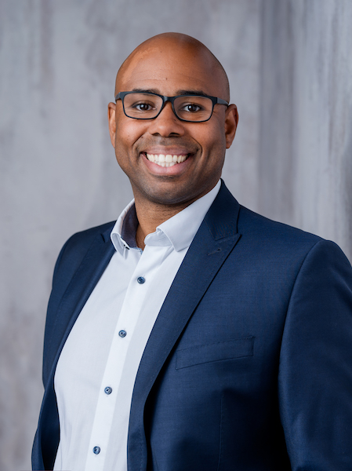

<!-- Source: https://rudypastel.com/en/home-en/ -->

# Dr. Rudy Pastel

## Freelance Data Scientist

PhD in applied mathematics.

[  Contact me  ](https://rudypastel.com/en/contact-en/)

[  More information  ](https://rudypastel.com/en/about-me/)

### Partner for your national and international projects

I am French and have been living and working in Germany for over 10 years. I am a perfect link for Franco-German teams.

### References

A brief overview of my clients with project examples.

München RE

since 06/2023

Migration of the entire codebase from R 3.6.3 to R 4.3.1. This included updating and verifying all dependencies, tests, and documentation. The project ensured that all internal and external scripts continued to function seamlessly.

BMW AG

07/2023 - 09/2023

Research on science and technology for automatic test case generation for cyber-physical systems. The goal was to identify state-of-the-art techniques to improve efficiency and automate the testing process. The results were documented and presented to the team.

BDO AG

11/2022 - 12/2022

Technical due diligence, reviewing the R codebase of an omics startup. The analysis included a comprehensive code review, performance testing, and creating a detailed report with recommendations for improving code quality and efficiency.

Munich Re

08/2021 - 12/2023

Training new recruits, developing R packages, and maintaining R-Shiny dashboards. This involved creating training materials, conducting workshops, and providing ongoing support to team members. Additionally, existing dashboards were expanded and optimized.

Munich Re

03/2019 - 07/2021

Development of an ETL software to replace Microsoft SSIS. The project involved creating a robust, scalable solution that made ETL processes more efficient and user-friendly. This included integrating various data sources and automating regular data import and transformation tasks.

Munich Re

02/2019 - 09/2019

Presentation of a new insurance product via a Shiny dashboard. The dashboard enabled interactive data analysis and visualizations to impress potential clients and support business decisions. Development involved close collaboration with the product team and iterative improvements based on feedback.

Symrise AG

12/2019 - 01/2020

Development of a data-driven replicator for chemical compounds, embedded in a dashboard. This tool allowed chemists to accurately predict and optimize the properties of compounds. A user-friendly interface was created to make complex calculations accessible.

Symrise AG

07/2018 - 08/2018

Refactoring of modeling and dashboard scripts into R packages. This included modularizing and optimizing the code to improve reusability and maintainability. Documentation and tests were also created to ensure the reliability of the scripts.

Lowell Financial Services GmbH

05/2018 - 09/2018

Development of a model to predict debt collection, embedded in a dashboard. The model enabled accurate forecasting of future payments and optimized resource allocation. The dashboard provided real-time visualizations and interactive analyses to support decision-making.

Volkswagen Data Lab Munich

09/2014 - 04/2017

Development of prototypes for business solutions, including time series forecasting and anomaly detection. These prototypes were used to test and validate innovative approaches to improving business processes. This involved collaboration with various departments to ensure the solutions met actual business needs.

### Example project

##### Replication of a chemical substance

The properties of a chemical compound depend on its molecular composition. If the compound is expensive, rare or difficult to obtain, you can try to recreate its composition by mixing the existing starting materials. The difficulty lies in finding a mixture that strikes an appropriate balance between properties and price.

The chemical company would like to automate this process in order to reduce the workload on the experts.

My task was to support the experts with data-driven replication.

[  Contact me  ](https://rudypastel.com/en/contact-en/)

### My services

I offer comprehensive services tailored to your needs, ensuring academic excellence and professional reliability.

!

###### R

I specialize in advanced programming and data analysis using R, ensuring precise statistical modeling, data visualization, and reproducible research practices.

!

###### SQL

I provide expert SQL programming and data analysis services, focusing on efficient database management, complex query optimization, and robust data integrity.

!

###### Shiny

I offer specialized services in Shiny app development, creating interactive web applications for dynamic data visualization and real-time analytical insights.

### Customer testimonials

This is what my clients say about me.

!

I highly recommend Rudy without hesitation. He is not only a talented coder but also a fantastic individual who positively impacts those he works with.

Dr. Sebastian Kaiser (Head of Machine Learning @ ERGO, Trainer, Lecturer)

## I am looking forward to new challenges.

Dr. Rudy Pastel

[  Contact me  ](https://rudypastel.com/en/contact-en/)
Scroll to Top
